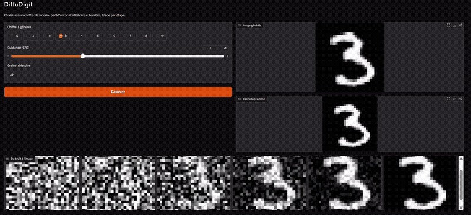
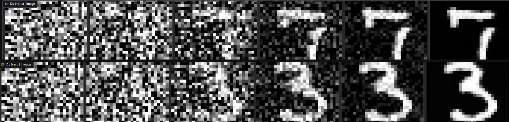
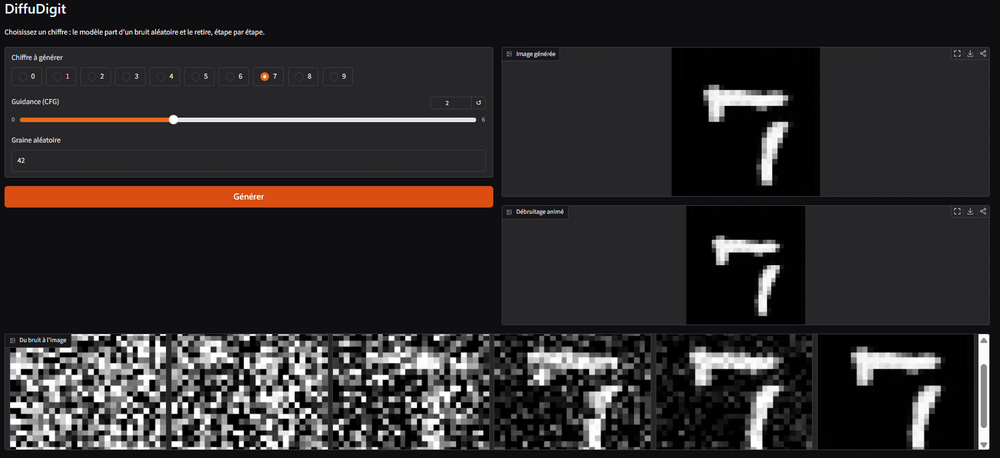
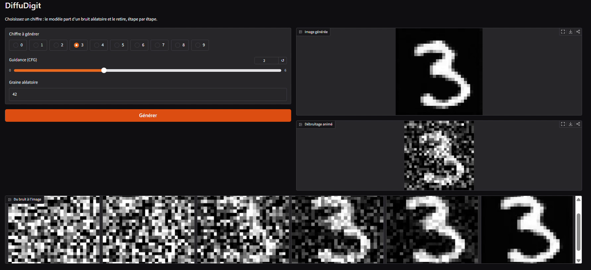

# DiffuDigit

   

**Un modèle d'IA générative entraîné à partir de zéro : il part d'un bruit aléatoire
et le transforme, étape par étape, en un chiffre manuscrit nouveau.**

C'est le même principe que **Stable Diffusion**, appliqué à des images de 28 × 28 pixels.
Ce projet est la mise en pratique de la formation **NVIDIA Deep Learning Institute :
« Generative AI with Diffusion Models »**.



## Du bruit à l'image

Le réseau de neurones enlève un peu de bruit à chaque étape (400 étapes au total).
Ici, 6 étapes du débruitage pour les chiffres 7 et 3 :



## L'application

| Chiffre 7 | Chiffre 3 |
|---|---|
|  |  |

On choisit un chiffre, la force du guidage (CFG) et une graine aléatoire, puis on clique sur
« Générer ». L'application affiche l'image finale, l'animation du débruitage et les étapes.

## Comment ça marche

1. **Entraînement : on abîme les images.** On prend une image MNIST et on lui ajoute du bruit
   gaussien, plus ou moins fort selon une étape *t* (de 0 à 399).
2. **Le réseau apprend à deviner ce bruit.** Un **U-Net** (≈ 1 million de paramètres) reçoit
   l'image bruitée, l'étape *t* et le chiffre voulu, et prédit le bruit ajouté.
3. **Génération : on fait le chemin inverse.** On part d'un bruit pur, et le réseau enlève
   le bruit prédit, étape après étape, jusqu'à obtenir un chiffre.
4. **Guidage (Classifier-Free Guidance).** Pendant l'entraînement, 10 % des images sont
   données sans le chiffre. À la génération, on compare les deux prédictions
   (avec et sans chiffre) pour pousser l'image vers le chiffre demandé.

| Élément | Choix |
|---|---|
| Modèle | DDPM, 400 étapes, planning linéaire (β de 1e-4 à 0,02) |
| Réseau | U-Net 28 → 14 → 7 → 14 → 28, conditionné par l'étape et le chiffre |
| Données | MNIST, 60 000 images de chiffres manuscrits |
| Entraînement | AdamW, lr = 1e-3, batch 128, perte MSE sur le bruit |
| Interface | Gradio |

## Lancer

```bash
git clone https://github.com/Rached12364/DiffuDigit.git
cd DiffuDigit
pip install -r requirements.txt
python app.py              # utilise le modèle déjà entraîné : diffudigit.pt
```

Ouvrir http://127.0.0.1:7860.

Pour entraîner à nouveau (MNIST est téléchargé automatiquement) :

```bash
python train.py --epochs 10            # une grille d'exemples est enregistrée dans samples/ à chaque époque
python train.py --epochs 3 --resume    # continuer à partir de diffudigit.pt
```

Sans carte graphique, une époque prend quelques minutes. Google Colab (GPU T4) est plus rapide.

## Fichiers

| Fichier | Rôle |
|---|---|
| `model.py` | U-Net, processus de diffusion (DDPM) et Classifier-Free Guidance |
| `train.py` | Entraînement sur MNIST |
| `app.py` | Application web (Gradio) |
| `diffudigit.pt` | Poids du modèle entraîné |
| `samples/` | Chiffres générés pendant l'entraînement |
| `docs/` | Captures et démo |

## Limites (honnêtes)

- Petites images en noir et blanc (28 × 28) : le but est de comprendre et de montrer
  le principe de la diffusion, pas de rivaliser avec Stable Diffusion.
- Certains chiffres générés peuvent être moins nets, surtout avec peu d'époques ou un guidage faible.

## Auteur

**Rached ILAHI** — élève ingénieur en génie informatique, ENICarthage

[LinkedIn](https://www.linkedin.com/in/rached-ilahi-5b5101366/) · [Portfolio](https://rached12364.github.io/)
